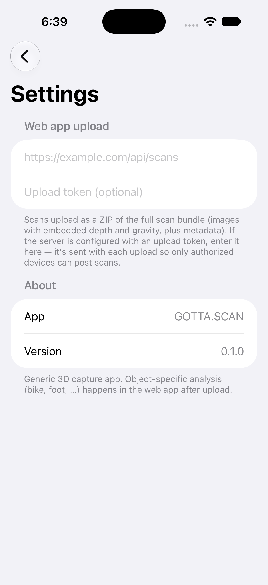

# GOTTA.SCAN

A photogrammetry pipeline that turns a guided iPhone scan into a clean,
measured, print-ready 3D model. Capture happens on the phone; everything else —
reconstruction, exports, and measurement — runs locally in a Mac desktop app.
No server required.

The capture app is deliberately **generic** — object-specific analysis (bike
parts, cycling shoes, feet, …) runs in the desktop app after the photos land on
the Mac.

## How it works

```
 iPhone (LiDAR)              Mac desktop app (GOTTA.SCAN)
 ───────────────            ──────────────────────────────────────
 Guided 3D capture   ──▶    Reconstruct  — Apple PhotogrammetrySession
 photos + depth +    photos   (RealityKit, Swift sidecar) → textured mesh
 gravity              folder   Export      — GLB / STL / 3MF / OBJ, mm scale
                               Measure     — object analysis (e.g. feet)
```

1. **Capture** — the iPhone app shoots a set of photos with embedded depth and
   gravity.
2. **Transfer** — move the photos to the Mac (AirDrop, or any shared/watched
   folder). The desktop app simply points at that folder.
3. **Reconstruct** — the app runs Apple's `PhotogrammetrySession` (via a bundled
   Swift sidecar) to produce a textured mesh.
4. **Export & analyze** — the app hole-fills the mesh, exports GLB / STL / 3MF /
   OBJ at real-world scale, and runs object-specific analysis (e.g. foot
   measurements).

## Components

| Path | What it is | Stack |
|------|-----------|-------|
| [`GottaScan/`](GottaScan/) | iOS capture app | SwiftUI, RealityKit, requires a LiDAR iPhone (Pro) |
| [`desktop/`](desktop/) | Mac desktop app — reconstruct, export, measure | Tauri v2 (Rust + WKWebView), Swift + Python sidecars |
| [`geometry/`](geometry/) | Shared, Django-free geometry package (measurements + exports) | Python 3.14, trimesh / pymeshlab |
| [`worker/`](worker/) | Swift `PhotogrammetryCLI` (compiled into the desktop app's sidecar) | Swift CLI over `PhotogrammetrySession` |

## Desktop app

A single Mac app that runs the whole pipeline locally. The window exposes three
actions, each backed by a bundled sidecar binary (no toolchain needed on the
target Mac):

- **Reconstruct from photos** — folder of HEIC/JPG → `model.usdz` + OBJ master.
- **Generate exports** — OBJ → GLB (m), STL (mm), 3MF (mm), OnShape OBJ, plus a
  manifest with real-world dimensions and watertightness.
- **Measure a foot** — OBJ → length, ball/heel widths, ball/instep girths, arch
  height.

### Build it

```bash
cd desktop
npm install
./build-sidecars.sh        # freeze the Python sidecar + compile the Swift CLI
npm run tauri build        # produces GOTTA.SCAN.app + .dmg
```

`build-sidecars.sh` stages two binaries as Tauri `externalBin`:
`gotta-sidecar` (frozen Python: measurements + exports) and `photogrammetry-cli`
(Swift reconstruction). For iterative work, `npm run tauri dev` uses the same
staged binaries.

> The `.app` is currently unsigned. It runs on the build machine; distributing
> to other Macs needs code-signing + notarization (Apple Developer account).

## Shared geometry

[`geometry/`](geometry/) is a standalone Python package (`gottascan-geometry`)
holding all mesh logic — canonical foot orientation, cross-section measurements,
hole-filling, and multi-format export. The desktop sidecar depends on it, so the
measurement/export code has a single source of truth.

## iOS app

SwiftUI app for guided LiDAR capture. It shoots each scan as a set of photos with
embedded depth and gravity; transfer those to the Mac for reconstruction.

<p>
  
</p>

> **Note:** guided 3D capture needs a LiDAR-equipped iPhone (Pro models, e.g.
> iPhone 17 Pro). On devices without LiDAR — including the simulator — the app
> shows a "device not supported" screen, so the capture flow can only be
> exercised on real Pro hardware.

Open [`GottaScan/GottaScan.xcodeproj`](GottaScan/) in Xcode to build and run.

## Status

Early, actively developed. The end goals are object-specific scanning workflows
for **bike parts** and **cycling shoes**; foot measurement is the first
object-specific analysis module.

## License

[GNU GPL v3.0](LICENSE).
