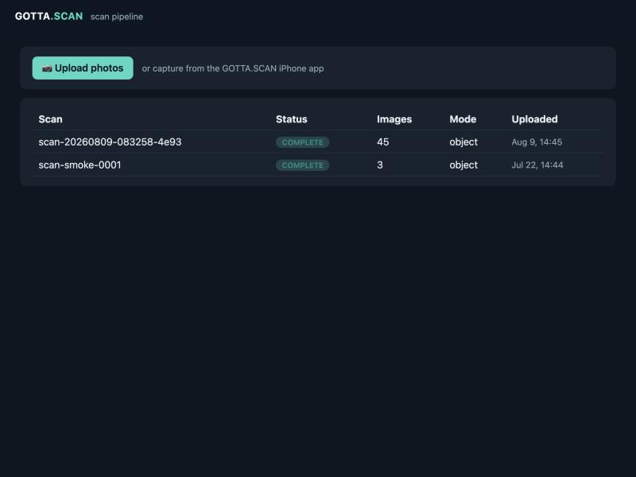
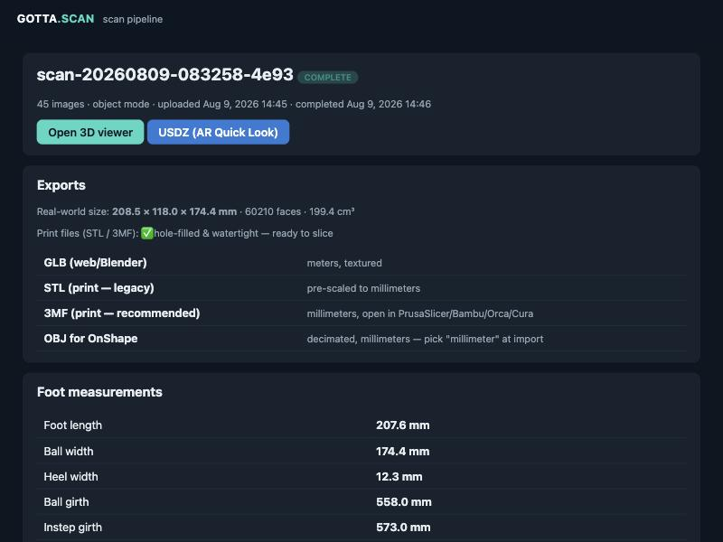
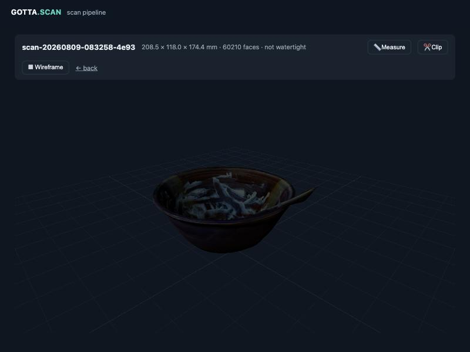

# GOTTA.SCAN

A photogrammetry pipeline that turns a guided iPhone scan into a clean,
measured, print-ready 3D model. Capture happens on the phone; reconstruction
runs on a Mac; everything is viewed, exported, and analyzed in a web app.

The capture app is deliberately **generic** — object-specific analysis (bike
parts, cycling shoes, feet, …) lives in the web app and runs after upload.

## How it works

```
 iPhone (LiDAR)          Web app (Django)           Mac worker
 ───────────────         ────────────────           ───────────────────────
 Guided 3D capture  ──▶  Receives bundle,      ◀──  Polls for queued jobs
 photos + depth +        queues the job             Runs Apple
 gravity, zipped         ─────────────────▶         PhotogrammetrySession
                         Stores the model           (RealityKit, Swift CLI)
 View / AR Quick Look ◀─ Exports GLB/STL/3MF   ◀──  Posts USDZ + OBJ back
                         + object analysis
```

1. **Capture** — the iPhone app shoots a set of photos with embedded depth and
   gravity, bundles them into a ZIP, and uploads it to the web app.
2. **Queue** — the web app stores the bundle and marks the scan as queued.
3. **Reconstruct** — a Mac worker claims the job and runs Apple's
   `PhotogrammetrySession` (via a bundled Swift CLI) to produce a textured mesh.
4. **Export & analyze** — the web app hole-fills the mesh, exports GLB / STL /
   3MF / OBJ at real-world scale, and runs object-specific analysis (e.g. foot
   measurements).
5. **View** — inspect the model in the browser (measure, clip, wireframe) or in
   AR via Quick Look on iOS.

## Components

| Path | What it is | Stack |
|------|-----------|-------|
| [`GottaScan/`](GottaScan/) | iOS capture app | SwiftUI, RealityKit, requires a LiDAR iPhone (Pro) |
| [`webapp/`](webapp/) | Upload, queue, 3D viewer, exports, analysis | Django 5.2, Python 3.14, SQLite |
| [`worker/`](worker/) | Mac photogrammetry worker | Python poller + Swift CLI over `PhotogrammetrySession` |

## Web app

Clean, dark UI for every scan in the pipeline.

| Scan list | Scan detail — exports + analysis | 3D viewer |
|-----------|----------------------------------|-----------|
|  |  |  |

The detail page surfaces real-world dimensions, watertight print files
(STL / 3MF), a GLB for web/Blender, an OBJ for OnShape, and — for feet — a full
measurement breakdown (length, widths, girths). The viewer supports measure,
clip, and wireframe.

### Run it

```bash
cd webapp
uv run python manage.py migrate
uv run python manage.py runserver 127.0.0.1:8300
```

Then open http://127.0.0.1:8300/.

Config via environment variables (defaults are dev-friendly; override for
deploy):

| Variable | Purpose |
|----------|---------|
| `GOTTASCAN_SECRET_KEY` | Django secret key |
| `GOTTASCAN_DEBUG` | `1` (default) / `0` |
| `GOTTASCAN_WORKER_TOKEN` | Shared secret the Mac worker sends as `X-Worker-Token` |
| `GOTTASCAN_UPLOAD_TOKEN` | Optional shared secret for scan uploads (`X-Upload-Token`); empty = open |

## Mac worker

Polls the web app for queued scans, reconstructs them with Apple's
`PhotogrammetrySession`, and posts the model back. The Swift CLI is compiled on
first use (cached in `worker/.build/`), so you need macOS with the Xcode command
line tools.

```bash
uv run --with requests worker/worker.py --server http://127.0.0.1:8300
```

Flags: `--once` (process one job and exit), `--simulate` (skip real
photogrammetry and emit a test cube, useful for exercising the export pipeline).

## iOS app

SwiftUI app for guided LiDAR capture. Point it at your web app in Settings; it
uploads each scan as a ZIP bundle (photos with embedded depth and gravity, plus
metadata).

<p>
  
</p>

> **Note:** guided 3D capture needs a LiDAR-equipped iPhone (Pro models, e.g.
> iPhone 17 Pro). On devices without LiDAR — including the simulator — the app
> shows a "device not supported" screen, so the capture flow can only be
> exercised on real Pro hardware.

Open [`GottaScan/GottaScan.xcodeproj`](GottaScan/) in Xcode to build and run.

## Status

Early, actively developed. The end goals are object-specific scanning workflows
for **bike parts** and **cycling shoes**; foot measurement is the first
object-specific analysis module.

## License

[GNU GPL v3.0](LICENSE).
